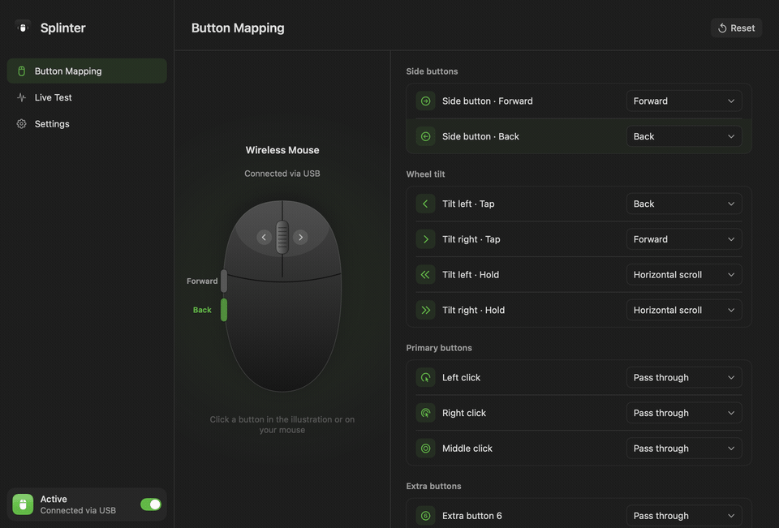

# Splinter

A lightweight macOS mouse remapper with English and Turkish interfaces.
**macOS 14+ · Apple Silicon & Intel · Apache-2.0**



Remap mouse buttons and wheel tilt to navigation, editing commands, desktop
actions or custom shortcuts. Select individual mice, exclude apps and inspect
input in Live Test. Works with standard USB and Bluetooth mouse events.

## Install

1. Download the universal ZIP from [Releases](https://github.com/Sanalarge/splinter/releases/latest).
2. Move `Splinter.app` to Applications and open it.
3. Enable **Accessibility** and **Input Monitoring** in **System Settings → Privacy & Security**.

Packages are ad-hoc signed, without Apple notarization. macOS may require
**Open Anyway** on first launch and permission approval after updates.
Hold **⌥ Option** for a normal click if you remap left click.

## Build

```sh
./build.sh --adhoc --universal
open build/Splinter.app
```

Requires Xcode Command Line Tools.
[Development & compatibility](CONTRIBUTING.md) · [Tests](Tests/README.md) · [Security](SECURITY.md) · [Screenshots](docs/images)
